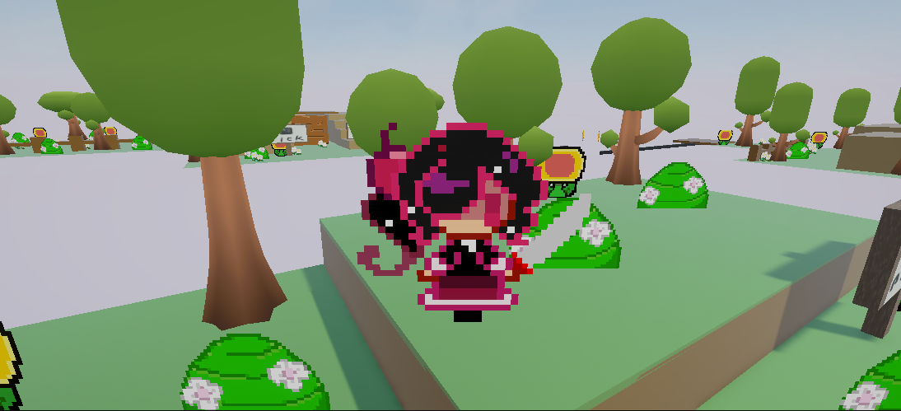

# ChoscoSantiago_TP2_Recuperatorio — Little Adventure (prototipo)

**Desarrollador:** Santiago Chosco
**LU:** TUV000783
**Materia:** Programación de Videojuegos 1
**Motor:** Unity 6.5 (6000.5.8f1)

## Descripción del juego

Prototipo de acción y aventura en 3D. El jugador controla a un personaje que
debe recorrer 3 niveles y recoger un cubo y entregarlo en la meta mientras
evita enemigos y obstáculos. Incluye una estación de curación para recuperar
vida durante el recorrido en un mundo 2.5D.

## Guía de controles

Mover al personaje  Flechas
Mover la camara ASWD 
Recoger y abrir cosas  E 
Activar poder especial de velocidad  Z 
Pausar el juego  P
Atacar Click derecho
Salta space 

## Requisitos

- **Raycast + LayerMask:** chequeo de suelo desde los pies del personaje para
  validar el salto, e interacción a distancia frontal para activar botones y
  consolas.
- **NavMesh:** malla de navegación generada sobre el terreno; enemigos con
  NavMeshAgent que patrullan, persiguen al jugador al detectarlo y atacan
  cuando entran en rango.
- **Salud y puntuación:** el jugador pierde vida al ser atacado, con un tiempo
  de inmunidad/cooldown entre ataques para que el contacto no reste toda la
  vida en un solo frame. Recolecta monedas para sumar puntos.
- **GameManager:** control centralizado de los estados (inicio, jugando, pausa,
  victoria y derrota), pausa congelando el tiempo y notificación de estado,
  vida y puntaje por consola.
- **Terreno:** escenario modelado con la Terrain Tool, con desniveles, rampas y
  texturizado de superficies.

## Estación de Curación

Zona de curación que aparece en el nivel 2 y detecta la presencia
del jugador mediante un Collider. Al ingresar herido, lo cura 10 HP cada 1.5
segundos de forma progresiva. Al alcanzar el límite de carga, la estación entra
en cooldown unos segundos y apaga sus luces/partículas mostrando el mensaje
"Estación en Recarga" por consola antes de volver a activarse.

## Opcionales elegidos

### Opción D (Zona de Desaceleración / Barro)
Hace que el jugador se mueva lento mientras está dentro de esa zona en el nivel
2, y le restablece la velocidad al salir.

### Opción F (Zona de Gas Tóxico)
Si el jugador entra a esa zona del nivel 1, pierde vida poco a poco; está a
salvo mientras permanezca afuera.

### Opción B (Power-Up de Invisibilidad)
Cuando el jugador lo agarra se vuelve invisible: el enemigo deja de perseguir y
vuelve a patrullar mientras dura el efecto. Solo aparece en el nivel 2.

## Correcciones aplicadas

- **Matriz de capas y colisiones:** se corrigió la matriz de capas para evitar
  el autodaño del jugador al atacar, y se asignó LayerMask a todas las
  superficies para que el Raycast de chequeo de suelo funcione correctamente
  en todo el escenario.

- **Interacción a distancia por Raycast:** se implementó el Raycast frontal
  desde el jugador para activar puertas, se ve en el nivel 2.

- **Daño de la IA y salud de enemigos:** se vinculó la lógica de ataque de la
  IA para que efectivamente inflija daño al jugador, y se extendió el sistema
  de salud a los enemigos para que puedan recibir daño.

- **Recolección de monedas con puntaje:** las monedas ahora suman puntos al
  sistema de puntuación del GameManager en lugar de solo destruirse.

- **GameManager completo:** se completó el GameManager para que administre las
  condiciones de victoria y derrota, además de la pausa, el estado de juego,
  y el puntaje.

- **Cooldown de daño:** el enemigo aplica daño con un tiempo de espera
  (`attackCooldown`) entre ataques, para que el contacto no reste toda la vida
  en un solo frame.

- **Estación de Curación:** agregada con regeneración progresiva de vida,
  límite de carga y cooldown con retroalimentación visual.

- **Requisitos opcionales:** se implementaron 3 opcionales de la lista
  (B, D y F), detalladas más arriba.

## Instrucciones para abrir y ejecutar el proyecto

1. Descargar o clonar el repositorio.
2. Abrir Unity Hub y hacer clic en **Add** para agregar la carpeta del proyecto.
3. Abrir la escena principal y presionar **Play**.
4. Usar los controles indicados en los carteles o del readme.

(Opcional: ejecutar el menú directamente, ya que hay un botón que al dar play
lleva a que elijas los 3 niveles y un tutorial)

## Capturas

