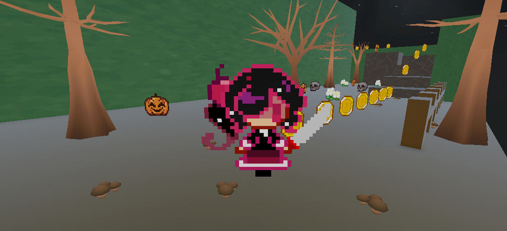

# TP2_PVJ1 — Liitle Adventure (prototipo)

**Desarrollador:** Santiago Chosco
**LU:** TUV000783
**Materia:** Programación de Videojuegos I
**Motor:** Unity 6.5 (6000.5.8f1)

## Descripción del juego

Prototipo de accion y aventura en 3D. El jugador controla a un personaje
que debe recorrer el escenario, recoger un cubo y entregarlo a la meta mientras
evita algunos obstaculos.

## Guía de controles
 
 Mover al personaje  WASD / Flechas 
 Recoger y soltar objetos  E 
 Activar poder especial de velocidad  Z 
 Pausar el juego  P 

## Requisitos 

- **Raycast + LayerMask:** chequeo de suelo desde los pies del personaje para
  validar el salto, e interaccion a distancia frontal para activar botones y
  consolas.
- **NavMesh:** malla de navegación generada sobre el terreno; centinelas con
  `NavMeshAgent` que patrullan y persiguen al jugador al detectarlo.
- **Salud y recolecion :** el jugador pierde vida y recolecta monedas.
- **GameManager:** control centralizado de los estados (inicio, jugando, pausa,
  victoria y derrota)
- **Terreno:** escenario modelado con la Terrain Tool, con desniveles, rampas y
  texturizado de superficies.

## Opcionales elegidos

### Opción B — Power-Up de velocidad
Script: `Assets/scripts/powerUp.cs`
Ítem recolectable que otorga al jugador una mejora temporal de velocidad al ser
recogido.

## Instrucciones para abrir y ejecutar el proyecto

1. Descargar o clonar el repositorio.
2. Abrir Unity Hub y hacer clic en **Add** para agregar la carpeta del proyecto.
3. Abrir la escena principal y presionar **Play**.
4. Usar los controles indicados para jugar.

(Opcional: ejecutar el menu directamente, ya que hay un boton que al dar play
lleva a que elijas 2 niveles)

## Capturas

